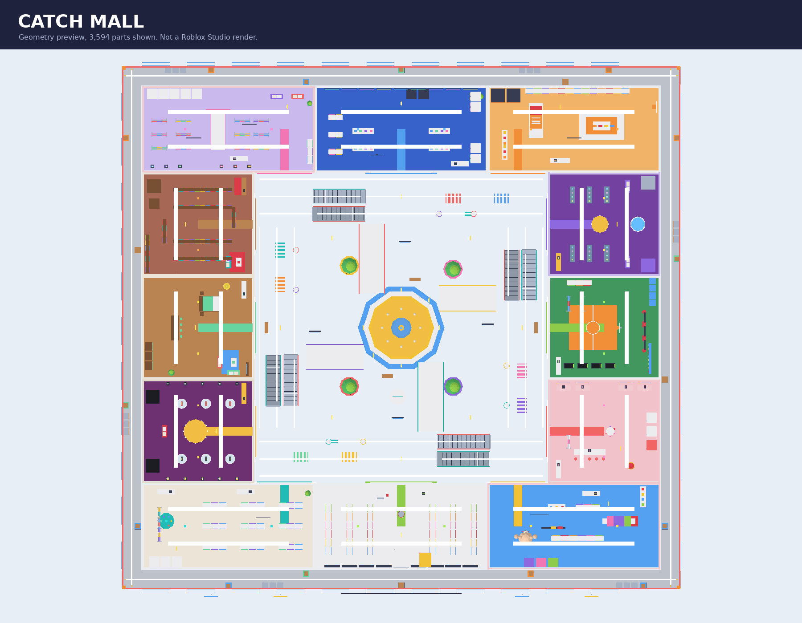
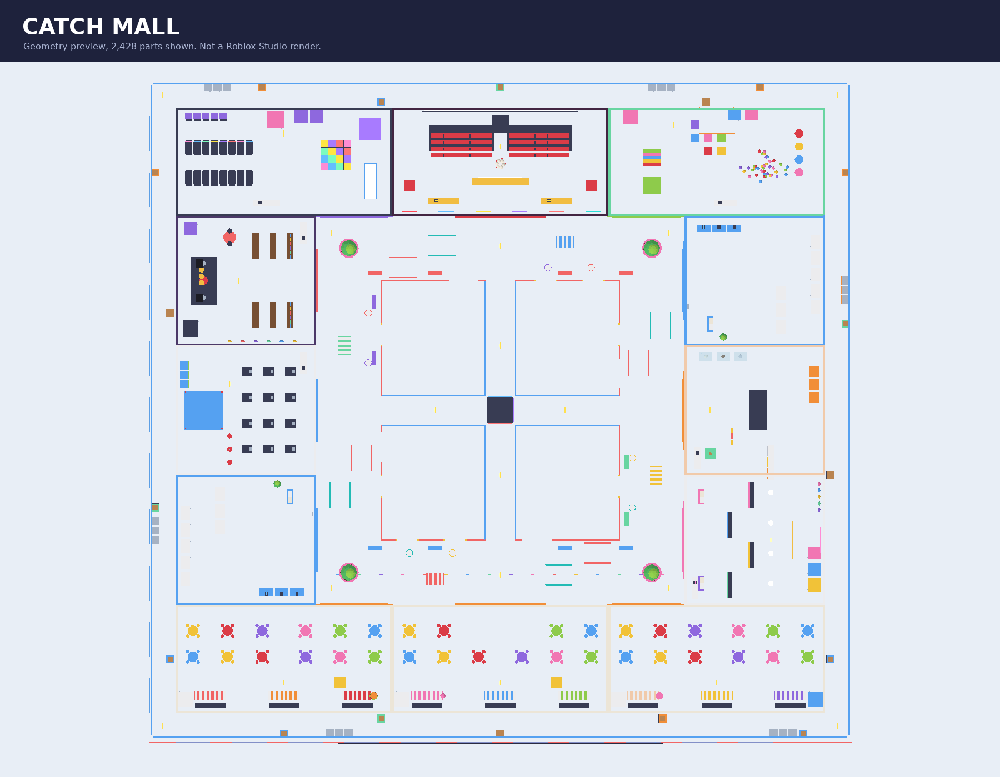

# Catch Me If You Can

An original Roblox multiplayer chase game set in **Catch Mall**: a bright, two-floor
shopping mall with a fountain atrium, escalators, a food court, an arcade, a cinema and
24 themed stores. Runners grab spinning coins and duck into fitting rooms, lockers and
stalls; hunters search the hiding spots, scan for movement and tag everyone they find.

**Version 0.4.0 is a full overhaul:** new expressive characters with eight outfits and
eight masks, the mall map (replacing Neon Heights), a hide / search / scan / coin system,
a bright redesigned interface with **Shop and Locker always on screen**, procedural mood
animation, a results screen with a reward breakdown, and developer-product coin packs.
Live status and the next steps are in [DEVELOPMENT_PROGRESS.md](DEVELOPMENT_PROGRESS.md);
the honest launch assessment is [docs/LAUNCH_READINESS.md](docs/LAUNCH_READINESS.md).

**Nothing in this version has been run in Roblox Studio.** Every check below uses
deterministic mocks of the Roblox boundary. Feel, rendering, audio, phones, real
DataStores and real Robux remain unverified; see the launch report for the playtest gate.




## Open the game directly — no plugins required

1. Download **[dist/Catch-Me-If-You-Can-Final.rbxl](dist/Catch-Me-If-You-Can-Final.rbxl)**. On GitHub,
   open the file and use **Download raw file**. The XML alternative is
   **[dist/Catch-Me-If-You-Can-Final.rbxlx](dist/Catch-Me-If-You-Can-Final.rbxlx)**; both contain the same
   game. Download one, not the GitHub HTML page.
2. In Roblox Studio, choose **File → Open from File** and select the downloaded
   place. Catch Mall is already present in the editor; it is not an empty place
   that requires pasting scripts. The map is reused at runtime.
3. Press **Play**. Output should say `Catch Mall initialized. 0.4.0`; if it
   shows an older version, download and open the updated file. A solo Studio
   session enters a clearly labeled practice round
   after the 16-second intermission and 5-second head start. Practice awards no
   XP, coins, rank, or wins. The avatar and game interface appear during Play.
4. For competitive testing, use Studio's **Server & Clients / Local Server** test
   controls with at least **2 clients**. For the full lobby use **12 clients**.
5. Before publishing, use an R15 avatar configuration and set the experience's
   maximum server size to **12**. The generated place sets R15; confirm published
   experience settings retain it. Follow [the testing checklist](docs/TESTING.md).

The `Final` filename identifies this requested delivery, not launch certification.
The older `dist/CatchMeIfYouCan.rbxl` / `.rbxlx` paths are rebuilt as byte-identical
compatibility copies; use the **Final** links above to avoid an older local download.

You can edit modules directly in Studio. For source-controlled work, edit `src/`
and rebuild; direct edits to a generated place are not automatically copied back
into the source tree.

## What is connected

- **Chase rounds:** up to 12 players, 1 hunter for 2–6 players and 2 for 7–12;
  180-second active rounds; 16-second intermissions; 5-second runner head starts;
  10-second results; round modifiers (Classic, Infection, Swarm, Slide Frenzy); fair
  hunter rotation, late-join spectating, death/reset and disconnect handling.
- **Catch Mall:** 324 × 304 studs, two floors plus a back-of-house service ring, a
  fountain atrium with a glass roof, 8 escalators, 4 grand stairs, 2 skybridges, balconies
  with 8 drop gaps, ladders, a food court, restrooms, an arcade, a cinema and 24 distinct,
  furnished stores whose interiors connect so chases loop through them. About 6,700 parts.
- **Hiding and searching:** 111 hide cells (fitting rooms, stalls, lockers, booths, a vault,
  a freezer and more). Hold E to hide for at most 7 seconds (12 s cooldown). Hidden runners
  cannot be tagged, but hunters can search a cell (E) to flush the occupant out, and SCAN (Q,
  25 s cooldown) shows movement and anonymous "occupied" markers within 45 studs.
- **Coins and close calls:** 55 spinning coins; each runner can pick up 25 per round
  (+1 coin, +3 XP each); close calls with hunters pay XP; hunters earn XP for finds.
- **Characters:** eight outfits and eight masks, free skin-tone and hair-color pickers, an
  expressive face that changes with the situation, and procedural arm/head poses for
  hunting, hiding, winning and losing. Cosmetic changes made mid-round apply after the round.
- **Interface:** bright candy-style HUD with a left dock where **Shop and Locker are always
  visible** (lobby, mall, active rounds, spectating, results; horizontal on short screens),
  an objective card, hide meter, ability bar, rarity-styled shop with live thumbnails and a
  3D fitting stage, daily missions, career, crew, settings, and a rewards screen. Menus never
  pause the round or protect the player; in a round they become a side drawer.
- **Progression and economy:** XP/levels, coins, ratings, wins/streaks, daily missions, a
  7-day login streak, 20 achievements and milestone cosmetics. Coins buy cosmetics only.
- **Persistence and shop:** server-owned inventory, DataStore retries with session leases,
  truthful save status, verified permanent game-pass entitlements, and developer-product
  coin packs through an idempotent `ProcessReceipt`. All IDs are 0 until you create them.
- **Feedback:** transient visual effects, camera lean, reduced-motion option, engine-bundled
  SFX fallbacks for coins, hiding, scanning, close calls and finds. Optional music, ambience
  and SFX overrides go in `Config.Audio`; no asset IDs are invented.

The leaderboard ranks players in the **current server** using their persistent
statistics. There is no global cross-server leaderboard or ranked matchmaking.
Rank is a transparent win/loss rating (+24 / −14), not a matchmaking skill estimate.

## Controls

| Action | PC | Controller | Touch |
| --- | --- | --- | --- |
| Move / look | WASD / mouse | Left / right stick | Roblox joystick / drag |
| Sprint | Hold Shift | Toggle L3 | Toggle RUN |
| Slide | C while moving | B while moving | SLIDE |
| Jump / attempt vault | Space | A | Native jump button |
| Tag as hunter | F | R2 | TAG |
| Hide / search / leave a spot | Hold E (jump to step out) | Hold the prompt button | Tap the prompt |
| Hunter scan | Q | X | SCAN |
| Locker | On-screen menu | Y | On-screen menu |
| Close menu | Close button / Escape | B | Close button |
| Spectate | On-screen arrows | Select arrows with UI navigation | On-screen arrows |

A vault request keeps normal jumping available when no suitable obstacle exists.
Movement ability cooldowns appear only after server acknowledgment. Opening menus
releases sprint; an open collection does not opt a player out of automatic rounds.

## Build and check the source

Linux x86_64 (Python 3, curl, unzip, and Git required):

```bash
./tools/bootstrap.sh       # Pinned official tools; SHA-256 verified
./tools/check.sh           # Compile, rebuild, deserialize, and run all eight suites
./tools/build.sh           # Rebuild just the two deliverable place files
```

Pinned versions: **Rojo 7.7.1**, **Luau 0.742**, **Lune 0.11.0**. Linux tools live
in ignored `.tooling/bin`. `aftman.toml` pins Rojo and Lune for other platforms;
install the corresponding official Luau CLI release separately. With those tools
and Python on PATH, Windows/macOS can run:

```text
python tools/check.py
```

For only a place build on any supported platform:

```text
rojo build default.project.json -o dist/CatchMeIfYouCan.sources.rbxlx
lune run tools/bake-place.luau dist/CatchMeIfYouCan.sources.rbxlx
```

Rojo creates the script/service hierarchy. Lune executes the authored map builder
with Roblox data types, bakes its geometry/lighting/spawns, and serializes **both**
place formats. The build then reopens both files and verifies their content. Lune
does not simulate the Roblox engine. A plain `rojo build` still runs the map builder
at Play time, but the two-step build is required for the city to be visible in Edit.

For live source editing, `rojo serve default.project.json` can sync scripts through
the Rojo Studio plugin. After map source changes, rebuild/reopen the place, or
remove the generated `Workspace.CatchMall` model before the next Play session so
`MapBuilder` regenerates it. Existing baked map geometry is deliberately reused (`MAP_VERSION`).

## Configuration and release checks

- [`Config.lua`](src/shared/Config.lua): round/movement tuning, data store, audio.
  Studio defaults to **temporary session-only data** and says so in the interface.
- [`Catalog.lua`](src/shared/Catalog.lua): cosmetics, coin prices, milestones, and
  real pass IDs. All Robux IDs are **0**, which disables paid purchase prompts.
- [Monetization guide](docs/MONETIZATION.md): create passes, set prices/IDs, publish,
  and test server-verified ownership. No real Robux transactions were tested here.
- [Testing checklist](docs/TESTING.md): required Studio, device, network, persistence,
  and performance checks before launch.
- [Progress and continuation](PROGRESS.md): verified results and remaining work.

**Performance design.** The mall is only 324 x 304 studs and the lobby sits about 90 studs outside it,
so any streaming radius that keeps chases and spectating correct would still load nearly the whole
map; `StreamingEnabled` is therefore left off, and weaker devices save work on the client instead
(`PerformanceController`): about 1,500 small decoration parts and the 51 lights are hidden beyond a
radius on MEDIUM/LOW, ambient particles are halved or stopped, sun rays/bloom/shadows are trimmed on
LOW, and the quality steps down automatically after sustained low FPS. Phones start on MEDIUM; the
player can pick AUTO/HIGH/MEDIUM/LOW in Settings > GRAPHICS. Budgets (enforced by tests): at most
7,000 parts, 600 transparent parts, 70 lights, 24 emitters, 150 signs, 100 parts per avatar.
These are budgets, **not measured frame rates**: measure on a real low-end phone before launch.

## Source layout

```text
src/shared/                   Configuration, catalog, pure rules, outfit geometry
src/server/Main.server.lua    Remotes, rate limits, service wiring
src/server/Services/          Rounds, movement, hiding, data, purchases, cosmetics
src/server/World/MallBuilder.lua Catch Mall (src/server/World/Mall/*), legacy MapBuilder.lua kept
src/client/Main.client.lua    Snapshot/event synchronization and controllers
src/client/Controllers/       UI, inputs/camera/poses, hiding, sound and visual feedback
tests/                        Rules, services, client, appearance, mall, enum regressions
tools/                        Verified tool bootstrap, build, and validation
dist/                         Direct-open Studio place files
```

The optional map and character renderers (`tools/render-map.py`,
`tools/export-characters.luau`, `tools/render-characters.py`) use Pillow and NumPy
to inspect actual geometry. Their images are not Studio renders or playtests.

All map and costume geometry is original project code. No free-model scripts,
external meshes, third-party asset packages, or paid movement advantages are used.
