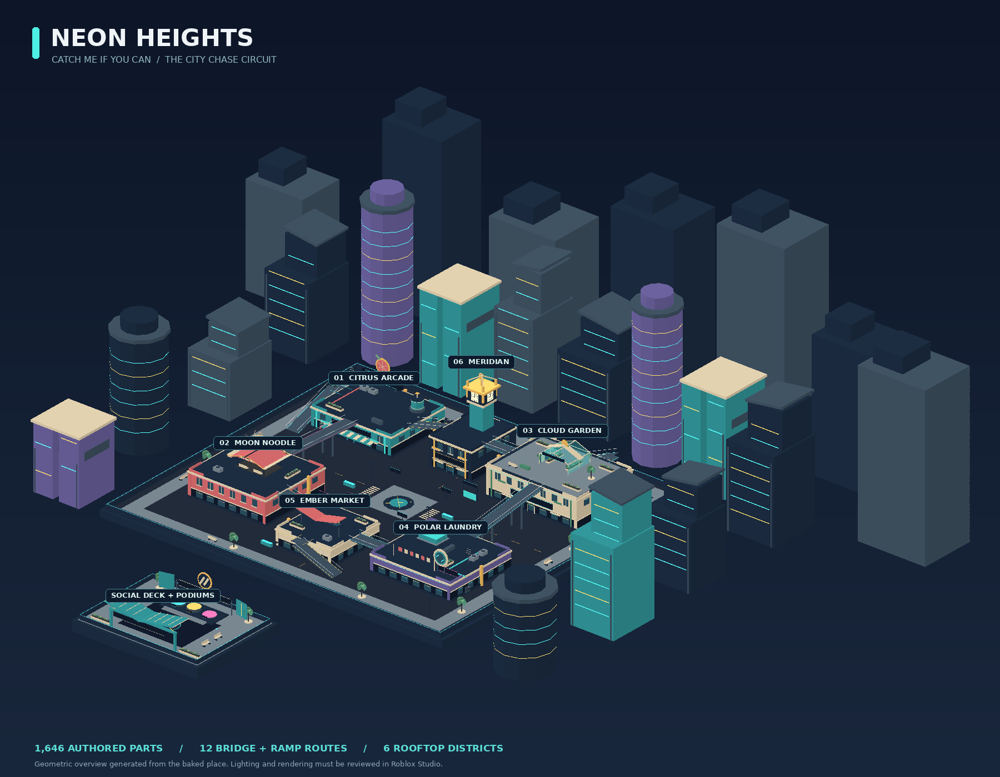
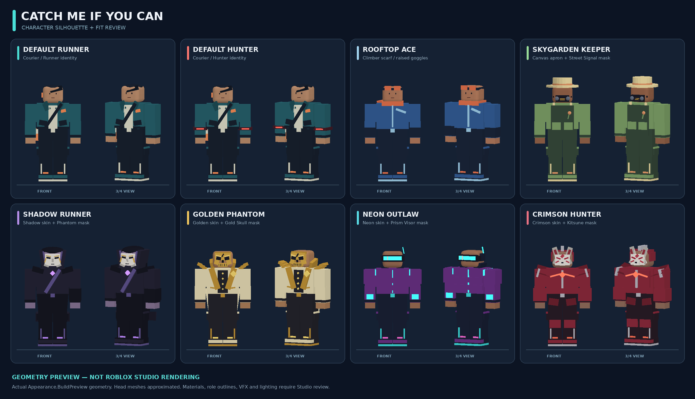

# Catch Me If You Can

An original Roblox multiplayer parkour chase game set in **Neon Heights**: a
mint-and-coral twilight city with rooftop gardens, a lantern restaurant, an arcade,
a clock tower, interconnected rooftops, and a separate social deck.

**Version 0.2.0 continues the existing game:** a streetwear character redesign,
slide repair, richer city architecture, and a larger character locker. See the
[update and first-play checklist](docs/UPDATE_0_2.md).

**Direct-open Studio places are included.** The user confirmed running, sprinting,
and vaulting in the previous place, and reported that sliding failed. The new
update passes the automated checks described below; its changed physics and
presentation still require Studio verification. Real purchases, live saves, and
mobile performance remain unverified. This is a development candidate, not a
claim of launch readiness.

## Open the game directly — no plugins required

1. Download **[dist/Catch-Me-If-You-Can-Final.rbxl](dist/Catch-Me-If-You-Can-Final.rbxl)**. On GitHub,
   open the file and use **Download raw file**. The XML alternative is
   **[dist/Catch-Me-If-You-Can-Final.rbxlx](dist/Catch-Me-If-You-Can-Final.rbxlx)**; both contain the same
   game. Download one, not the GitHub HTML page.
2. In Roblox Studio, choose **File → Open from File** and select the downloaded
   place. Neon Heights is already present in the editor; it is not an empty place
   that requires pasting scripts. The map is reused at runtime.
3. Press **Play**. Output should say `Neon Heights initialized. 0.2.0`; if it
   shows an older version, download and open the updated file. A solo Studio
   session enters a clearly labeled practice round
   after the 16-second intermission and 5-second head start. Practice awards no
   XP, coins, rank, or wins. The avatar and game interface appear during Play.
4. For competitive testing, use Studio's **Server & Clients / Local Server** test
   controls with at least **2 clients**. For the full lobby use **12 clients**.
5. Before publishing, use an R15 avatar configuration and set the experience's
   maximum server size to **12**. The generated place sets R15; confirm published
   experience settings retain it. Follow [the testing checklist](docs/TESTING.md).

The `Final` filename identifies this requested delivery, not launch certification.
The older `dist/CatchMeIfYouCan.rbxl` / `.rbxlx` paths are rebuilt as byte-identical
compatibility copies; use the **Final** links above to avoid an older local download.

You can edit modules directly in Studio. For source-controlled work, edit `src/`
and rebuild; direct edits to a generated place are not automatically copied back
into the source tree.

## What is connected

- **Chase rounds:** up to 12 players, 1 hunter for 2–6 players and 2 for 7–12;
  180-second active rounds; 16-second intermissions; 5-second runner head starts;
  10-second results; fair hunter rotation, late-join spectating, death/reset and
  disconnect handling, last-runner presentation, and a final 30-second chase cue.
- **Movement:** accelerated sprinting, a server-driven slide with eased propulsion and joint poses, geometry-checked vaulting,
  native jumping, third-person camera feedback, and server cooldown, movement,
  range, and line-of-sight validation. Hunters use the same parkour abilities.
- **Neon Heights:** six recognizable rooftop districts with swept canopies, round landmark signs,
  layered facades, varied skyline silhouettes and a framed lobby, twelve broad bridge/ramp
  routes, six ladders, optional vault routes, two animated timing gates with
  bypasses, signs, gardens, vents, storefronts, skyline, and a podium lobby.
- **Custom presentation:** loading/lobby, live HUD, role announcements, collection
  shop, locker, 3D previews, daily quests, career, settings, server leaderboard,
  results, spectator cycling, touch controls, and controller focus navigation.
- **Original cosmetics:** seven distinct geometric outfits with R15/R6 fitting and five independent
  masks; coin/milestone/free unlocks; 42 skin/mask combinations including no mask;
  layered streetwear, sneakers and independent Hunter signal cuffs; sprint trails,
  tag effects, lobby emotes, animated victory podiums, and nameplates.
- **Progression:** XP/levels, coins, performance rating ranks, wins/streaks, separate
  hunter/runner statistics, UTC daily quests, achievements, and milestone cosmetics.
- **Persistence and shop:** server-owned inventory and transactions, DataStore
  retries and expiring session leases, truthful save status, and verified permanent
  game-pass entitlements. Collections and VIP provide cosmetics only.
- **Feedback:** original transient visual effects, camera lean/FOV, optional reduced
  motion, and quiet Roblox engine-bundled SFX. Optional uploaded music and sound
  overrides are configured in `Config.Audio`; no invented asset IDs are required.

The leaderboard ranks players in the **current server** using their persistent
statistics. There is no global cross-server leaderboard or ranked matchmaking.
Rank is a transparent win/loss rating (+24 / −14), not a matchmaking skill estimate.





## Controls

| Action | PC | Controller | Touch |
| --- | --- | --- | --- |
| Move / look | WASD / mouse | Left / right stick | Roblox joystick / drag |
| Sprint | Hold Shift | Toggle L3 | Toggle RUN |
| Slide | C while moving | B while moving | SLIDE |
| Jump / attempt vault | Space | A | Native jump button |
| Tag as hunter | F | R2 | TAG |
| Locker | On-screen menu | Y | On-screen menu |
| Close menu | Close button / Escape | B | Close button |
| Spectate | On-screen arrows | Select arrows with UI navigation | On-screen arrows |

A vault request keeps normal jumping available when no suitable obstacle exists.
Movement ability cooldowns appear only after server acknowledgment. Opening menus
releases sprint; an open collection does not opt a player out of automatic rounds.

## Build and check the source

Linux x86_64 (Python 3, curl, unzip, and Git required):

```bash
./tools/bootstrap.sh       # Pinned official tools; SHA-256 verified
./tools/check.sh           # Compile, rebuild, deserialize, and run all six suites
./tools/build.sh           # Rebuild just the two deliverable place files
```

Pinned versions: **Rojo 7.7.1**, **Luau 0.742**, **Lune 0.11.0**. Linux tools live
in ignored `.tooling/bin`. `aftman.toml` pins Rojo and Lune for other platforms;
install the corresponding official Luau CLI release separately. With those tools
and Python on PATH, Windows/macOS can run:

```text
python tools/check.py
```

For only a place build on any supported platform:

```text
rojo build default.project.json -o dist/CatchMeIfYouCan.sources.rbxlx
lune run tools/bake-place.luau dist/CatchMeIfYouCan.sources.rbxlx
```

Rojo creates the script/service hierarchy. Lune executes the authored map builder
with Roblox data types, bakes its geometry/lighting/spawns, and serializes **both**
place formats. The build then reopens both files and verifies their content. Lune
does not simulate the Roblox engine. A plain `rojo build` still runs the map builder
at Play time, but the two-step build is required for the city to be visible in Edit.

For live source editing, `rojo serve default.project.json` can sync scripts through
the Rojo Studio plugin. After map source changes, rebuild/reopen the place, or
remove the generated `Workspace.NeonHeights` model before the next Play session so
`MapBuilder` regenerates it. Existing baked map geometry is deliberately reused.

## Configuration and release checks

- [`Config.lua`](src/shared/Config.lua): round/movement tuning, data store, audio.
  Studio defaults to **temporary session-only data** and says so in the interface.
- [`Catalog.lua`](src/shared/Catalog.lua): cosmetics, coin prices, milestones, and
  real pass IDs. All Robux IDs are **0**, which disables paid purchase prompts.
- [Monetization guide](docs/MONETIZATION.md): create passes, set prices/IDs, publish,
  and test server-verified ownership. No real Robux transactions were tested here.
- [Testing checklist](docs/TESTING.md): required Studio, device, network, persistence,
  and performance checks before launch.
- [Progress and continuation](PROGRESS.md): verified results and remaining work.

The bounded city intentionally loads as a whole so lobby spectators can follow
any runner. Streaming is disabled; the authored map is limited to 1,646 parts,
10 local lights without shadow casting, two moving gates, and at most 87 parts per
avatar including Hunter accessories. These are geometry budgets, **not measured mobile frame rates**.

## Source layout

```text
src/shared/                   Configuration, catalog, pure rules, outfit geometry
src/server/Main.server.lua    Remotes, rate limits, service wiring
src/server/Services/          Rounds, movement, data, purchases, cosmetics
src/server/World/MapBuilder.lua Authored city and runtime timing gates
src/client/Main.client.lua    Snapshot/event synchronization and controllers
src/client/Controllers/       UI, inputs/camera, sound and visual feedback
tests/                        Rules, service, client, appearance, map regressions
tools/                        Verified tool bootstrap, build, and validation
dist/                         Direct-open Studio place files
```

The optional map and character renderers (`tools/render-overview.py`,
`tools/export-characters.luau`, `tools/render-characters.py`) use Pillow and NumPy
to inspect actual geometry. Their images are not Studio renders or playtests.

All map and costume geometry is original project code. No free-model scripts,
external meshes, third-party asset packages, or paid movement advantages are used.
